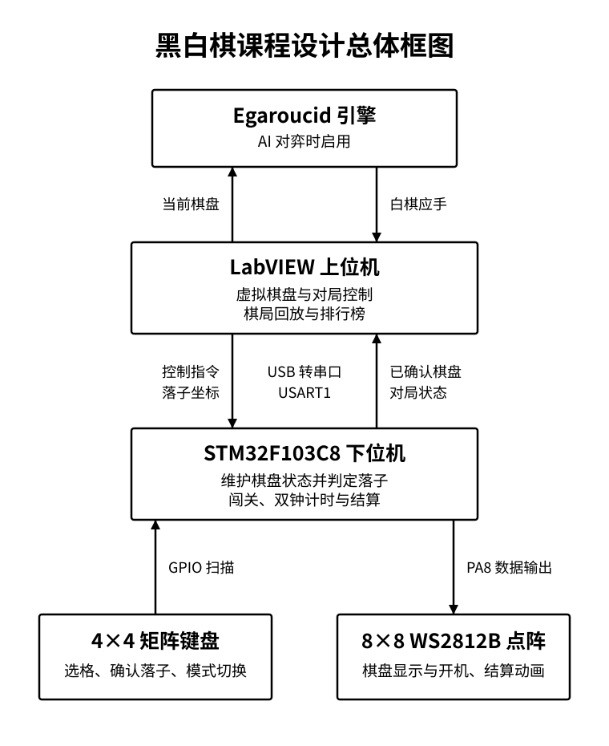

# 总体方案与阶段目标

状态：待用户审阅的实现方案草案 v0.1。2026-11-17 仅完成规划建项，不启动实现。

2026-11-18 进展：用户已明确授权 #20 的基础功能审查和离线 CubeMX 工程创建；按指定 second/thrid 工程参考配置 HSE→PLL×9→72 MHz，保留 C8/SWD。该项只覆盖工程初始化与本机验证，不代表下列全部实现阶段已经启动或实物条件已确认。结果入口见 `firmware/Othello_Basic/README.md` 与 `docs/reviews/2026-11-18-basic-function-audit.md`。

## 1. 目标与影响范围

最终目标是通过 `requirements.md` 中 B01–B07、A01–A07、C01–C03 全部必做验收；AI 属于后续扩展。

本次影响范围：本地 Git、文档、任务模板和日志，以及账号 `cancan7777777` 的公开 GitHub 仓库、Issues 与里程碑。原始总体方案保留；不接线、不刷固件、不下载 AI、不安装工具、不编写实验程序。

候选技术路线继承参考方案：STM32F103C8T6、成品 8×8 WS2812B RGB 点阵、4×4 矩阵键盘、USB-UART、LabVIEW 9。最终硬件型号和环境需核实。

## 2. 架构和职责

当前实现的程序流程和两端原理图见[系统框图与程序流程图](../系统框图与程序流程图.md)。

- **STM32 是实局状态权威**：维护棋盘、回合、合法落子和翻转、运行/暂停/结束状态、模式、计时、分数和连败计数。所有来源的落子最终都由 STM32 校验。
- **下位机模式能力明确保留**：闯关和计时列在任务书下位机要求中；因此不采用原稿“累计逻辑主要集中在 LabVIEW”的分工。分数公式、显示方式和独立运行边界须先确认，不在两端各算一套权威得分。
- **LabVIEW 是主操作界面和记录端**：配置串口、发送控制请求、显示已确认状态、本局分与总分，存储与回看历史、显示与保存排行。UI 不提前当作请求已成功。
- **AI 是可选建议服务**：仅返回推荐或评价；不绕过规则、不直接驱动 LED。回放/分析状态与正在进行的实局分开。

## 3. 硬件与交互草案

1. 4×4 键盘以行、列选择及确认覆盖全部 64 格，结合菜单或明确的复用入口提供完整游戏控制。先画出真实 16 键的键位表，再核对数字键与功能键是否冲突；不假定能给每个功能独占一个键。
2. 棋盘颜色采用三种可分辨状态表示空、黑、白；黑棋可用自定义颜色，避免“熄灭”同时表示空与黑。具体颜色与亮度待实物确认。
3. 先核实点阵蛇形/行优先映射、DIN 方向、供电与共地，再冻结 GPIO、定时器、DMA 和串口分配。原稿引脚表仅为候选。
4. 以实际模块说明核对电源、电平转换、保护和去耦；不在本次规划中批准接线或上电。
5. 不假定已有额外 LCD 或实体控制按钮。`WIN/OVER` 可考虑点阵滚动显示，须与老师确认后写入交互规范。

## 4. 游戏与通信设计草案

- 规则首先按任务书“一方无合法位置即结束”建验收；标准 pass 仅在得到确认后采用。
- 统一棋盘内部坐标、黑白编码、先手与开局方向。参考方案的 0 起始坐标、`0/1/2` 编码可作候选，必须在协议冻结时明确。
- 候选串口默认 `115200 / 8N1`、文本帧、序号、CRC16，参考原稿 `@TYPE,SEQ,DATA,CRC16\n`。本次不把示例当作完整可实施协议。
- 协议任务须明确：类型、长度、数据格式、CRC 覆盖范围与编码、序号范围/回绕、ACK/ERROR 关联、幂等、超时重试、最大帧长、粘包/半包、断线快照、会话/局号、命令冲突及退出语义。
- 除原稿列出的命令外，需覆盖结束退出、参数配置、时间、当前局分/总分、连败、模式状态、作弊编辑、终局原因。具体命名由协议任务冻结。
- UI 串口参数仅允许实际支持的组合；不承诺 STM32/USB-UART 支持任意数据位和停止位组合。
- STM32 确认后更新状态并同步两端；断线重连以最新完整快照为准，不能盲目重放旧落子。

## 5. 分阶段目标、依赖与验收门槛

日期未给出，不编造工期。以下按依赖排序，每个任务必须由用户明确启动后实施。

| 阶段 / 里程碑 | 工作与产出 | 验收门槛 | 依赖 |
|---|---|---|---|
| M0 需求与基线 | 本次文档、Git/GitHub、澄清规则、核实环境、接口与键位设计 | 当前建项先完成；规则/硬件/协议任务未完成前不能宣布 M0 完全通过 | 无 |
| M1 下位机基础 | LED 映射、键盘、合法落子与翻转、开局/终局、串口端点 | B01–B05 对应用例通过；可由实体键盘完成基础对局 | M0 中相应前置任务 |
| M2 上位机与基础联调 | LabVIEW 棋盘、串口设置、落子和完整状态同步 | B06–B07；双端状态一致，错误请求不污染棋盘，无需串口助手 | 协议冻结、下位机端点 |
| M3 进阶与记录 | 双端游戏控制、闯关、计时、作弊、历史、排行榜与保存 | A01–A07 全部通过，边界情况和文件持久化可复核 | M1、M2；计分规则冻结 |
| M4 完整验收 | 异常恢复、连续演示、界面检查、报告与操作说明 | B/A/C 全部通过；留存证据，已知缺陷有明确结论 | M3 |
| M5 可选 AI 扩展 | Python/Egaroucid、推荐与对弈、分析复盘 | 必做验收保持通过，AI 兼容规则、可降级且不阻塞 | M4 及用户另外启动 |

完成下位机基础后可分别推进上位机界面与进阶模式，但首次双端协议与规则需先冻结。这里是任务依赖说明，本次不启动并行开发或子代理。

## 6. 当前待定决策

- 游戏：见 `requirements.md` 的 D01–D08，优先确认计分、188 阈值和终局规则。
- 硬件：准确板卡/晶振、点阵型号及映射、独立供电、电平转换、实际键盘布局、下载方式；未证实器件已经具备。
- 软件：LabVIEW 9 实际版本/位数、Windows、NI-VISA 兼容组合、Keil/CubeMX 使用范围；原稿 EViews 8 是否为统计软件或将 uVision 混称，需确认。
- 项目：课程截止时间、小组成员与分工、报告模板、是否全做 AI 扩展。
- GitHub：用户已明确要求仓库公开并上传方案与要求；当前 token 缺少 Projects 权限，仓库/里程碑/Issues 可先使用。未创建看板时必须明确报告，不能以本地任务表冒充看板。

上述未定项不阻止本次规划建项，但阻止依赖它们的实现。不得凭默认建议关闭澄清任务。

## 7. 风险、回滚与验证

| 风险 | 处理与验证 | 回退方式 |
|---|---|---|
| 计分不明确或恰好 188 无法自然到达 | 先书面冻结公式与阈值规则，构造 187/188/超过 188 的场景 | 保持规则任务未完成，不擅自更改验收语义 |
| 下位机功能被上位机替代 | 逐项核对 A01–A04 的实际执行端、输入入口和显示证据 | 调整职责和协议再实现 |
| 旧 LabVIEW/驱动环境不兼容 | 先记录实际环境并做最小连接验证 | 使用经核实的兼容环境；变更技术路线需用户确认 |
| LED 供电、映射、时序与串口冲突 | 按器件说明核对并在驱动阶段单独验证 | 回到已确认接线/驱动版本；上电异常停止硬件操作 |
| 双端不同步或重复命令 | 用会话、版本/序号、确认和完整快照测试重试与重连 | 以 MCU 快照恢复 UI；拒绝过期请求 |
| AI 规则或命令不兼容、范围过大 | 必做功能先通过；AI 独立开关、超时降级 | 关闭 AI 保持课程系统完整可演示 |
| 项目记录与远端状态不一致 | 每任务核对 Issue、journal、commit、push 与远端 HEAD | 补同步；用新提交修正，禁止强推抹历史 |

文档与程序变更通过 Git 可回退；共享历史使用 `git revert`，不随意重写历史。远端仓库/Issue 不自动删除，有误以更正记录和关闭说明处理。

## 8. 本次交付与验证

交付：需求矩阵、方案、带依赖与验收标准的任务、Git/日志规则和初始提交。验证内容：需求逐条覆盖、原稿保持原样、没有实现代码、Issues/里程碑存在且状态真实、本地分支与远端提交同步。

本次不运行硬件测试、不声称实验功能已实现，也不创建仅为文档排版而存在的自动化测试。
