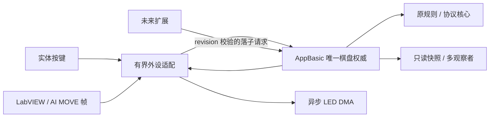

# 基础主程序与创新功能接入约定

本实现参考用户提供的 199 行基础 main，使用项目实际已有的 OtGame/ot_* 核心接口，未直接复制不匹配的 OT_Game/OT_Init 等符号。参考原文件保持不变。

## 入口和分层

- Core/Src/main.c：CubeMX 初始化、主循环调度、唯一一组 HAL 回调转发。应用内容均在 USER CODE 区域。
- app_basic.c/.h：私有棋盘、键盘操作、协议调用、版本与状态通知；不包含 HAL。
- app_platform.c/.h：UART RX 环形缓冲/TX 有界帧队列、键盘扫描/消抖、PWM/DMA 点阵；不直接修改棋盘。
- othello.c/.h、ot_protocol.c/.h：原包的规则/CRC/GET/MOVE/STATE/ERROR 核心，原样复用。
- application_sources.txt：应用源文件登记表；tools/update-app-sources.ps1 和 CubeMX 生成脚本按登记表加入 MDK 工程，避免重新生成后源文件漏编译。

## 当前基础行为

- 上电初始化中心 2 黑 2 白、黑先手，串口主动排队发送 seq=0 的 STATE。
- 2/8/4/6 移动光标，5 合法落子，0 重新开始；其余键保留。长按不重复落子，多键按下后必须完全释放才允许下一次按键。
- 合法落子至少翻 1 子；任一方无合法位置即结束，维持任务书字面规则，不静默引入 pass。
- GET/MOVE 请求先经现有 CRC 和 revision 校验。TX 队列满时暂存完整输入帧，不先执行落子再等回复。
- 物理落子/本局重开后推送 STATE；光标移动仅刷新 LED。重开时 revision 继续递增，避免旧请求刚好撞上 revision=1。
- RX 中断仅收字节/重装接收；业务处理、发送排队和 DMA 启停在主循环。RX 过载/超长行丢弃到 LF 恢复，不把残缺帧当命令。
- 点阵采用低亮度自定义黑棋蓝、白棋灰白、光标琥珀闪烁，GRB，800 kHz，DMA 缓冲区与待显示状态分离；默认蛇形映射可以通过 app_config.h 修改。

## 给未来创新功能的硬性边界

1. **棋盘只有一个写入口。** 扩展不能持有或自行维护另一个可写 OtGame；用 AppBasic_GetSnapshot 获取值拷贝，用 AppBasic_RequestMove 提交坐标和 expected_revision。AI 思考期间局面已变化时返回 STALE，不能把旧推荐强行落在新局面。
2. **通知是只读、同步、短操作。** 最多 4 个观察者各有独立 context/slot，不能互相覆盖。回调中落子、重开、初始化、修改观察者或再次处理帧均被拒绝；应记录任务，回到主循环再提交，不能阻塞做 AI 搜索。快照指针仅在回调期间有效，需保存时自行拷贝。
3. **协议 V1 不静默扩展。** 现有 GET/MOVE/STATE/ERROR、CRC、坐标和终局语义保留。未识别的 X_AI 等命令仍返回 COMMAND 且不改棋盘。以后需要模式/作弊/新字段，先定义版本/能力协商和专用命令，不改变 MOVE 的原有字段解释。
4. **HAL 回调只定义一次。** main 统一转发，驱动内部核对 USART1、TIM1/CH1。新模块不得再次定义同名全局 HAL 回调；需要新增路由时在唯一分发处按外设/通道接入。
5. **硬件资源有独占者。** TIM1_CH1/PA8、DMA1_CH2 属于点阵；USART1/PA9/PA10 属于协议；PB0/PB1/PB10–PB15 属于键盘；PA13/14 保留 SWD。未来新增外设不得启用争用 DMA1_CH2 的请求或占用这些引脚，需先更新资源表和 .ioc；不要直接改 CubeMX 生成的初始化。
6. **生成与构建有登记。** 新源文件加入 application_sources.txt；初始化/注册留在 USER CODE，避免生成代码和手写代码两份状态。每次改接口或 .ioc 后重新生成、编译并运行基础回归。

这些约定和回归覆盖当前已知接入点，不能保证未知功能绕过约定、耗尽 CPU/RAM 或改变规则时仍无冲突。闯关/计时/作弊/排行/AI 本次均未实现，也没有自行决定 188 分计分公式。

## 验证与硬件边界

运行 tools/test-basic-app.ps1 验证业务层和 HAL 模拟适配；运行 tools/build-keil.ps1 验证目标编译；tools/cubemx/generate.ps1 验证重新生成保留入口和应用源。

已知硬件假设仍须核实：8 MHz HSE、矩阵排针行列、LED 第三针/供电/电平/方向/版本时序。默认 CCR=23/58，尾部 256 个零周期约 320 us，不是实物波形验收。这里仅编写和离线验证，没有接线、上电或刷机。

本独立 worktree 的 CubeMX 6.3 再生成返回 KO（具体原因未确定）；未把它当作重生成通过。现有工程已按登记表手动同步、Keil 构建和主机测试通过。以后修改 .ioc 时，须检查 CubeMX 的实际返回和生成文件，再执行 tools/update-app-sources.ps1 并重新构建；不能只凭 USER CODE 或源清单声称所有未来生成场景都无冲突。
