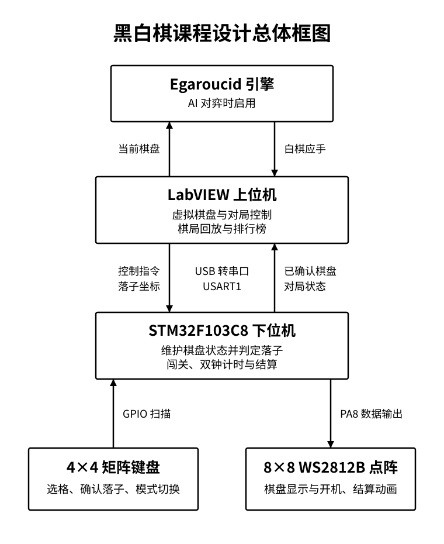
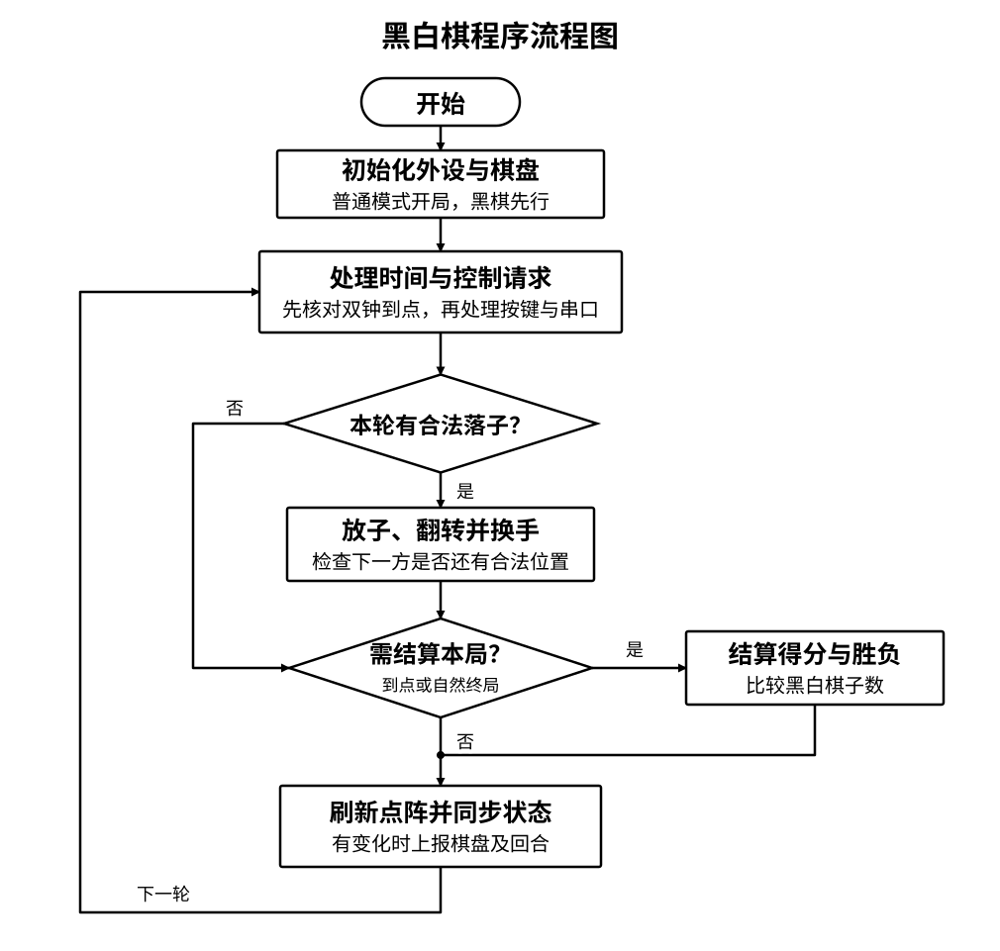
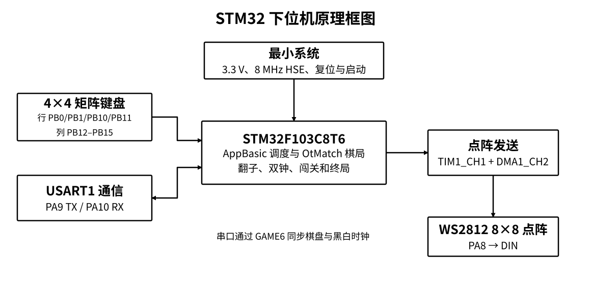
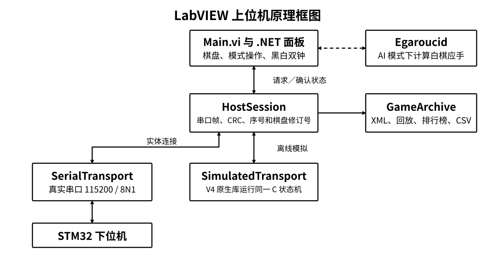

# 黑白棋系统框图与程序流程图

四张图按当前 STM32 固件和 LabVIEW 项目绘制。背景和所有方框为白色，文字、轮廓和连线为黑色。可直接将 SVG 原图插入 Word。

## 1. 系统框图

STM32 统一处理实体键盘和上位机发来的落子请求。LabVIEW 显示设备确认的棋盘，AI 模式通过本机 Egaroucid 计算白棋应手。 [SVG 原图](docs/diagrams/system.svg)

## 2. 程序流程图

固件先更新时钟，再处理按键和串口。合法落子后翻子、换手并检查终局。计时局到点或自然终局按棋子数结算。 [SVG 原图](docs/diagrams/program-flow.svg)

## 3. STM32 下位机原理框图

矩阵键盘由 GPIO 扫描，USART1 交换指令和棋盘状态，TIM1 与 DMA 通过 PA8 驱动点阵。 [SVG 原图](docs/diagrams/stm32.svg)

## 4. LabVIEW 上位机原理框图

串口与离线模拟均由 `HostSession` 接收完整状态，棋局存档可用于回放、排行和 CSV 导出。 [SVG 原图](docs/diagrams/labview.svg)
